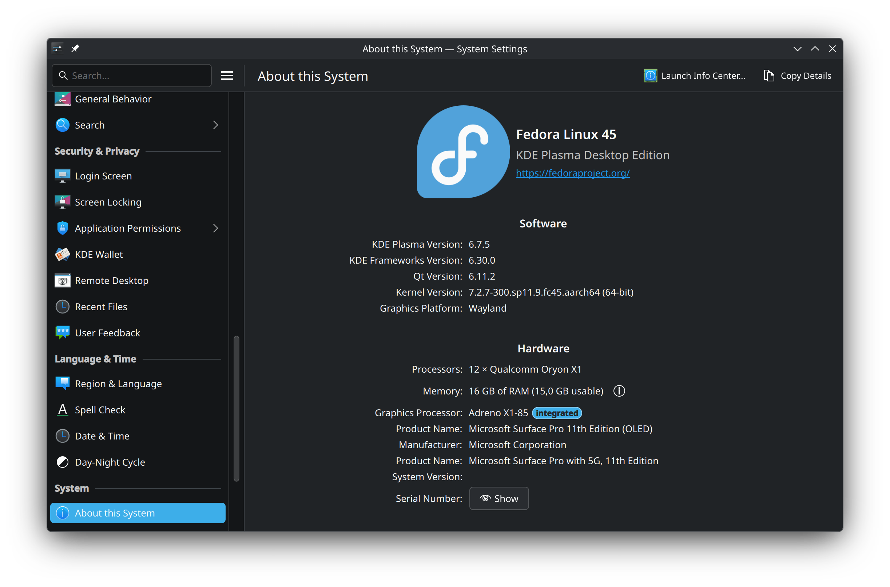

# Fedora Live ISO for Surface Pro 11 (all known SKUs, OLED and LCD)



This repository builds a Fedora 45 installer for the Microsoft Surface Pro, 11th Edition. It covers every known SKU:
the X1E80100 OLED (including the 5G model) and the X1P64100 LCD. It is for owners of that tablet who want Fedora
next to Windows.
There is no ISO to download: the image contains firmware and sensor files copied from your own Windows
installation, so you build it yourself, on the Surface, in WSL; the kernel alone takes about an hour.

What you get: Fedora's own kernel rebuilt with the community's Surface Pro 11 patches, a support package with the
device's firmware and settings, the pen daemon, the sensor stack, and Fedora's live ISO remastered with all of it,
for the Workstation or the KDE Plasma Desktop edition. How the pieces fit, and the words the guides use:
[`docs/guide/overview.md`](docs/guide/overview.md).

## Current versions

| Component | Version |
|---|---|
| Fedora | 45 (compose 1.4), Workstation or KDE Plasma Desktop |
| Kernel | Fedora's `kernel-7.3.5-300.fc45`, SP11 revision 3 (`7.3.5-300.sp11.3.fc45.aarch64`) |
| Support RPM (`sp11-surface-support`) | 3.23 |
| Signed boot image for Secure Boot (`sp11-kernel-secureboot-<kernel>`, optional, built with your own key) | 1-1, with the boot stub `262.1-sp11.1` |
| Pen daemon (`sp11-iptsd`) | 3.1.0-4.sp11 |
| Sensors stack | hexagonrpc 0.5.0-8, libssc 0.4.4-3, iio-sensor-proxy 3.9-3.sp11.2, sp11-sensors 1.16 |
| HDR library (`libdisplay-info`, Fedora's with upstream's DisplayID 2.0 support) | 0.3.0-2.sp11.1 |

## What works

Tested on the 5G SKU (`Surface_Pro_with_5G_11th_Edition_2077`). Every row was confirmed on 2026-11-02 on a Fedora
45 Workstation installation running kernel 7.2.15 and the other versions above; on 2026-11-03 a fresh installation
from the ISO built that day from the 45 release media 1.4 confirmed the rows from boot to suspend again, Flatpak,
the Windows entry and USB-C aside. Kernel 7.3.3 (revisions 1 and 2, 2026-11-08 and 09) confirmed every row in
use again, with the standard checks, the microphone, GPS, mobile data and a night's sleep. Revision 3
(2026-11-12) confirmed the rows in use once more, with the standard checks and an 8-hour sleep, and added HDR.
Revision 5 (2026-11-16) passed the standard checks and its round's checks by hand; its second probe of the 5G
modem's PCIe controller brought the modem up in the one boot whose link was not up at first (2026-11-19). Kernel
7.3.5 revision 1 (2026-11-19) passed the standard checks and its round's checks by hand, and opening the cover
wakes the tablet again. With support 3.12 and a signed boot image (2026-11-21) Fedora started with Secure Boot on,
through a sleep and with mobile data. Revision 2 (2026-11-22) passed the standard checks and its round's checks
by hand, with Secure Boot on, and so did revision 3 with support 3.17 (2026-11-23). The same day a fresh
installation from the ISO built with revision 3 and support 3.18, its root encrypted, passed its round's checks by
hand, with Secure Boot on. With support 3.19 a key sealed in the TPM then opened that root without a prompt.
The KDE Plasma Desktop edition builds from the same RPMs; its rows were last confirmed on 2026-10-08 with kernel
revision 11 (7.2.9). The results by date: [`docs/verified.md`](docs/verified.md).

| Feature | Fedora 45 Workstation, Fedora's 7.3.5-300 (sp11.3) |
|---|:-:|
| Boot from the internal NVMe drive | ✅ |
| Encrypted root (LUKS2), the passphrase typed on the Type Cover at the start | ✅ |
| Encrypted root opened by the TPM at the start, with Secure Boot on and a GRUB password | ✅ |
| Display with GPU acceleration | ✅ |
| Backlight (brightness slider) | ✅ |
| HDR on the built-in display (GNOME: Settings, Displays), with the `libdisplay-info` RPM, from kernel 7.3.3 revision 3 | ✅ |
| Wi-Fi | ✅ |
| Bluetooth | ✅ |
| Touchscreen | ✅ |
| Multi-touch (pinch, two-finger scroll) | ✅ |
| Pen | ✅ |
| Speakers | ✅ |
| Microphone | ✅ |
| Keyboard and touchpad | ✅ |
| Battery status | ✅ |
| Power profiles (GNOME: its Power Mode sets the Surface's platform profile) | ✅ |
| USB-C charging and data | ✅ |
| Suspend and resume | ✅ |
| Flatpak | ✅ |
| Windows in the GRUB menu | ✅ |
| Flex Keyboard and Slim Pen 2 pairings shared with Windows | ✅ |
| Sensors: readings from the accelerometer, gyroscope, magnetometer/compass and ambient light sensor (`ssccli`, `monitor-sensor`), with the sensors RPMs | ✅ |
| Sensors: auto-rotation on the desktop, with the sensors RPMs (GNOME: its auto-rotate button, with the keyboard folded back or detached) | ✅ |
| Tablet mode: keyboard and touchpad off while the keyboard is folded back | ✅ |
| Sensors: automatic screen brightness | ✅ |
| GPS on the 5G SKU: the location for applications through GeoClue (GNOME: Location on), with a view of the sky | ✅ |
| 5G modem: mobile data with a nano-SIM (GNOME: Mobile Network), from kernel revision 8 | ✅ |
| Cameras: front and rear (GNOME Snapshot, Firefox) | ✅ |
| Front camera's light while the camera is in use | ✅ |
| IR camera (face login) | ❌ |
| NPU (AI acceleration) | ❌ |

✅: confirmed on the tested unit. ❌: not covered by this project. Notes:

- Secure Boot can be switched on for the installed system with a signing key of your own: Fedora then starts
  through a signed boot image and the kernel runs locked down (2026-11-21, kernel 7.3.5 revision 1), and Windows
  starts from GRUB's menu (2026-11-22). The installer needs it off, and so does a kernel without a signed image
  ([`docs/guide/secure-boot.md`](docs/guide/secure-boot.md), [`docs/secure-boot.md`](docs/secure-boot.md)).
- Fedora has the tablet's TPM (Microsoft Pluton) from kernel 7.3.5 revision 2: `/dev/tpm0` and `/dev/tpmrm0`,
  the firmware's boot measurements, and Windows uses the TPM as before (2026-11-22). With Secure Boot on, a key
  sealed in it opens an encrypted root at the start (2026-11-23,
  [`docs/guide/secure-boot.md`](docs/guide/secure-boot.md)). The start takes about 3 s longer with the TPM
  ([`docs/hardware.md`](docs/hardware.md), TPM).
- GPS needs no SIM; near a window the first position came within about a minute, away from windows none in two
  minutes ([`docs/gnss.md`](docs/gnss.md)).
- HDR takes two parts: the kernel's DisplayPort HDR commits and a rebuild of Fedora's `libdisplay-info` that
  reads the panel's HDR data. Switching it blanks the screen for about a second. Under GNOME 51.1 a rotation of
  the tablet switches HDR off again, and a Fedora update of `libdisplay-info` takes the switch away until the
  RPM is rebuilt ([`docs/guide/troubleshooting.md`](docs/guide/troubleshooting.md),
  [`docs/display.md`](docs/display.md)).
- Asleep, the tablet drew 0.33 W over 8 hours with kernel revision 5 or later, against 0.85 W before. From
  revision 9 the modem keeps its power through the sleep at no measurable cost (0.32 W), and with support 3.9
  mobile data is back within 2 s of a wake; from revision 13 Wi-Fi is back about 13 s after a wake instead of
  21 s
  ([`docs/sleep.md`](docs/sleep.md), [`docs/modem.md`](docs/modem.md), [`docs/hardware.md`](docs/hardware.md),
  Wi-Fi).
- The screen comes back about 2.5 s sooner after a wake since pen daemon 3.1.0-4 and kernel 7.2.14 revision 2:
  the pen daemon's sleep hook no longer holds the wake for 1.3 s, and the kernel's resume takes 1.4 s instead of
  2.6 s, since it no longer powers the touch controller twice nor brings the three PCIe links up one after the
  other ([`docs/sleep.md`](docs/sleep.md), Wake).
- Hardware video decoding works from kernel revision 7: a 720p VP9 clip decoded frame for frame in GStreamer, and
  H.264 and H.265 clips once their colorimetry was relabelled ([`docs/hardware.md`](docs/hardware.md), Video
  codec).
- USB-C data works with the plug either way round since kernel 7.2.15 revision 1: a USB 3 stick runs at
  5000 Mb/s on both ports, turned over as well. Before, it was not found turned over, because the retimer got its
  mode before it was told of the connection ([`docs/hardware.md`](docs/hardware.md), USB-C data).
- Under KDE Plasma, auto-rotation could stop until iio-sensor-proxy was restarted, and with automatic brightness on
  the tablet did not stay asleep; the sensors RPMs fix both since libssc 0.4.4-3 (2026-10-07) and iio-sensor-proxy
  3.9-3.sp11.2 (2026-10-08) ([`docs/guide/troubleshooting.md`](docs/guide/troubleshooting.md)).

### LCD variant (X1P64100)

The 13-inch LCD model uses the smaller X1P64100 and shares the non-5G OLED SKU string
(`Surface_Pro_11th_Edition_2076`), so the build tells them apart by the SoC and the panel: X1P64100 with an LG
Display (`LGD`) panel takes `qcom/x1p64100-microsoft-denali.dtb`. On the unit of
[issue #2](https://github.com/FadyAckad/fedora-linux-surface-pro-11/issues/2) (2026-11-20), Fedora boots with
display, speakers, sensors, Wi-Fi/Bluetooth and battery; with the 8380 GPU zap shader Mesa uses the
Adreno (`glxinfo -B`: `freedreno`, `Accelerated: yes`) and gnome-shell idles at a few percent CPU instead of driving
2880x1920 with llvmpipe. Checked on 2026-11-20 with the shader repair:

| Feature | X1P64100 LCD | X1E80100 OLED |
|---|:-:|:-:|
| Boot, display + GPU, HDR | ✅ | ✅ |
| Touch/pen, keyboard/touchpad, tablet mode, rotation | ✅ | ✅ |
| Speakers, microphone, cameras (front/rear/IR stream) | ✅ | ✅ |
| Sensors | ✅ | ✅ |
| Backlight slider and auto-brightness | Needs PWM fix | ✅ |
| Wi-Fi, Bluetooth, battery, suspend, power profiles | ✅ | ✅ |
| USB-C charging and data | ✅ | ✅ |
| Hardware video decode | ❌ | ✅ |
| IR face login (Windows Hello), NPU | ❌ | ❌ |
| 5G / GPS | N/A (no modem) | ✅ on the 5G SKU |

A [second LCD report](https://github.com/FadyAckad/fedora-linux-surface-pro-11/pull/4#issuecomment-7121238139)
confirmed that the reported brightness can change without the panel dimming, and that only the first CPU cluster
scales. Local fixes restored backlight control and scaling on all three clusters, and enabled hardware H.264/H.265
encode and decode. Those fixes are not yet in this branch ([`docs/verified.md`](docs/verified.md)).

## Status and scope

- Unofficial community project, not affiliated with Microsoft, Qualcomm, or Fedora. No warranty.
- Tested on the 5G OLED SKU and, from 2026-11-20, on an X1P64100 LCD unit (issue #2). The hardware checks accept
  every known Surface Pro 11 SKU: `Surface_Pro_11th_Edition_2076` (non-5G OLED and LCD),
  `Surface_Pro_11th_Edition_For_Business_2085` (non-5G OLED) and
  `Surface_Pro_with_5G_11th_Edition_2077` (5G OLED). The non-5G OLED and the LCD share the `2076` string, so step
  05 picks the tree by SoC and panel vendor (`X1E80100`+`SDC` for OLED, `X1P64100`+`LGD` for LCD); only the 5G
  SKU takes the modem tree. No build from a non-5G OLED SKU has been reported.
- Secure Boot must be disabled for the installer: the kernel is a local build of Fedora's kernel package and is
  not signed. An installed system can run with it enabled once you sign a boot image with a key of your own
  ([`docs/guide/secure-boot.md`](docs/guide/secure-boot.md)).
- Windows must stay on the device: the build reads the hardware identity, the built-in radio's Bluetooth address,
  the ADSP/CDSP firmware (and, on the OLED, the video firmware) and the sensor configuration and registry from it.
  Without them an installed system has no audio, battery reporting or hardware video decoding. The GPU shader is
  the exception: the OLED takes it from Windows, the LCD from Fedora's `qcom-firmware`.
- The LCD device tree requests the 8380 GPU zap shader, but an LCD unit's Windows DriverStore ships
  `qcdxkmsucpurwa.mbn` instead, which the secure world rejects with `-EINVAL`. An LCD build therefore takes
  `qcdxkmsuc8380.mbn` from Fedora's `qcom-firmware` (Dell XPS 13 9345 build) when Windows has no 8380 copy; the
  hash is pinned in `sp11.conf`.
- The support RPM and the ISO contain proprietary Qualcomm firmware copied from your own Windows installation. Do
  not redistribute them; point other people to this repository instead.

## Quick start

Requirements: a Fedora aarch64 distribution in WSL on the Surface, Windows interop (`powershell.exe`), `sudo`
(passwordless for unattended runs), 80 GiB free disk space and internet access. A plain `git clone` is enough: the
build itself fetches the pinned commits of the kernel fork (the submodule `linux-sp11`, about 290 MB) and of the
hexagonrpc fork (the submodule `hexagonrpc`).

Once per unit, export its sensor registry from Windows (one UAC prompt):

```bash
scripts/75-export-sensor-registry.sh
```

Then build. The kernel takes about an hour after the downloads; keep WSL running meanwhile:

```bash
scripts/build-all.sh
```

For the KDE Plasma Desktop image instead of Workstation (the kernel and RPMs are the same and are reused):

```bash
FEDORA_EDITION=KDE-Desktop scripts/build-all.sh
```

The ISO lands in `build/out/`, for example
`Fedora-Workstation-Live-45-1.4-SP11-7.3.5-300.sp11.3.fc45.aarch64.iso` or
`Fedora-KDE-Desktop-Live-45-1.4-SP11-7.3.5-300.sp11.3.fc45.aarch64.iso`, with a `.sha256` beside it. Then
write it to a USB stick and install: [`docs/guide/install.md`](docs/guide/install.md).

## Reporting results

The hardware checks accept every known Surface Pro 11 SKU, but no build from a non-5G OLED SKU has been reported
and the LCD's feature table is not complete yet. If you build or install on another unit, open an issue with the
SKU, the SoC, the panel vendor, the ISO's name, which rows of the table worked, and for anything that did not, the
output of `sudo /usr/libexec/sp11/sp11-diag`. That file names your Bluetooth controller and devices by address;
remove them before posting if you prefer.

## Documentation

Start here:

- [`docs/guide/overview.md`](docs/guide/overview.md): how the build works, and a glossary of the terms used here.
- [`docs/guide/install.md`](docs/guide/install.md): writing the USB, the firmware settings, the installer, the
  first boot.
- [`docs/guide/update.md`](docs/guide/update.md): updating the support RPM and installing a new SP11 kernel.
- [`docs/guide/secure-boot.md`](docs/guide/secure-boot.md): switching Secure Boot on for the installed system,
  with a signing key of your own, and opening an encrypted root with the TPM.
- [`docs/guide/troubleshooting.md`](docs/guide/troubleshooting.md): diagnostics, known limitations, what earlier
  releases fixed.

Building:

- [`docs/guide/build.md`](docs/guide/build.md): requirements, the pipeline, its options, steps and checks.
- [`docs/guide/build-rpms.md`](docs/guide/build-rpms.md): building one set of RPMs alone for an installed system.
- [`docs/guide/sensors.md`](docs/guide/sensors.md): the sensors stack: install, update, check, reset.
- [`docs/guide/bluetooth-pairings.md`](docs/guide/bluetooth-pairings.md): sharing the Flex Keyboard and Slim Pen 2
  pairings with Windows.
- [`docs/guide/new-release.md`](docs/guide/new-release.md): moving to a new Fedora compose or kernel.

Background:

- [`docs/guide/design.md`](docs/guide/design.md): what the scripts decide for you, and why.
- [`docs/guide/support-rpm-history.md`](docs/guide/support-rpm-history.md): what each support RPM version changed.
- [`docs/guide/layout.md`](docs/guide/layout.md): what each file of the repository is.
- [`docs/guide/credits.md`](docs/guide/credits.md): license and credits.

For maintainers: the working notes under `docs/`, indexed in [`docs/README.md`](docs/README.md), hold the verified
facts, measurements and lessons the guides rest on.

## License

GPL-3.0-or-later for the repository's content (`LICENSE`). Everything third-party is downloaded and packaged at
build time. The proprietary firmware and sensor files come from your own Windows installation and never enter the
repository. Details: [`docs/guide/credits.md`](docs/guide/credits.md).
